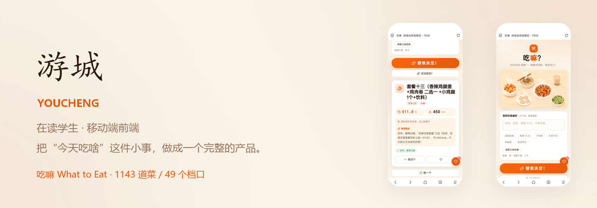

  

# 你好，我是 youcheng10d

做移动端前端，正在把“今天吃啥”这件小得不能再小的事，做成一个完整的产品。

## 现在在做

**吃嘛 · What to Eat** —— 面向大学生的食堂菜品推荐 Web 应用。

说一句偏好（“减肥、预算 15 元、不想吃辣”），它从真实菜品库里挑出一道菜，并告诉你去哪个食堂、哪个档口。目前已录入重庆城市科技学院两个食堂的 1143 道菜、49 个档口，纯前端、零后端、零构建工具。

- 在线体验：[youcheng10d.github.io/what-to-eat](https://youcheng10d.github.io/what-to-eat/)（手机打开效果最佳）
- 仓库：[youcheng10d/what-to-eat](https://github.com/youcheng10d/what-to-eat)
- 开发日志：[v0.1](https://github.com/youcheng10d/what-to-eat/blob/main/docs/blog/blog-01-v0.1.md) ｜ [v1.0](https://github.com/youcheng10d/what-to-eat/blob/main/docs/blog/blog-02-v1.0.md) ｜ [v1.2](https://github.com/youcheng10d/what-to-eat/blob/main/docs/blog/blog-03-v1.2.md) ｜ [v2.0](https://github.com/youcheng10d/what-to-eat/blob/main/docs/blog/blog-04-v2.0.md)

## 技术栈

- 前端：HTML / CSS / 原生 JavaScript，移动端优先，无框架
- 数据：PowerShell 采集与清洗管道，构建期生成静态 JSON
- 正在补：Python、Node.js

## 怎么做

开发全程 AI 辅助，但重点放在三件事上：意图对齐、架构可控、全链路可复现。原始 Prompt、关键设计决策和每次验证都保留在仓库的 docs 里，任何人 clone 下来都能照着复现一遍。

## 产品观

吃嘛的每个决策都不靠拍脑袋。v2.0 的方向来自 24 份学生问卷：口味档位、档口滑窗、单卡与三卡形态，全部是从答案里一条条翻译出来的。
