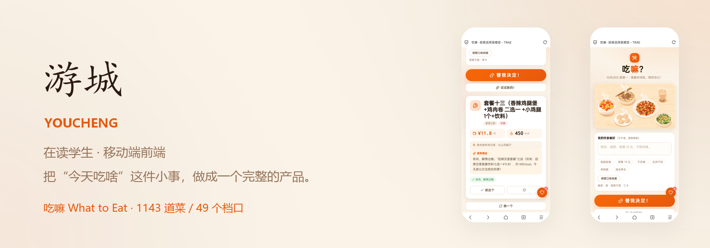

  

# 你好，我是 youcheng10d

重庆城市科技学院计算机科学与技术专业，大二。
正在把“今天吃啥”这件小得不能再小的事，做成一个真的有人在用的产品。

## 现在在做

**吃嘛 · What to Eat** —— 面向大学生的食堂菜品推荐 Web 应用。

说一句偏好（“减肥、预算 15 元、不想吃辣”），它从真实菜品库里挑出一道菜，并告诉你去哪个食堂、哪个档口。

| 项目 | 现状 |
| --- | --- |
| 菜品库 | 2670 道，65 个档口 |
| 已采集学校 | 重庆城市科技学院；成都文理学院（192 家店、8355 道） |
| 形态 | 纯前端，零后端、零构建工具 |
| 测试 | 冒烟 / 回归 / 集成 / 金文件 / 变异五层，接入 GitHub Actions |

- 在线体验：[youcheng10d.github.io/what-to-eat](https://youcheng10d.github.io/what-to-eat/)（手机打开效果最佳）
- 仓库：[youcheng10d/what-to-eat](https://github.com/youcheng10d/what-to-eat)
- 开发日志（8 篇）：[01](https://github.com/youcheng10d/what-to-eat/blob/main/docs/blog/blog-01-v0.1.md)、[02](https://github.com/youcheng10d/what-to-eat/blob/main/docs/blog/blog-02-v1.0.md)、[03](https://github.com/youcheng10d/what-to-eat/blob/main/docs/blog/blog-03-v1.2.md)、[04](https://github.com/youcheng10d/what-to-eat/blob/main/docs/blog/blog-04-v2.0.md)、[05](https://github.com/youcheng10d/what-to-eat/blob/main/docs/blog/blog-05-v2.1.md)、[06](https://github.com/youcheng10d/what-to-eat/blob/main/docs/blog/blog-06-v2.1.2.md)、[07](https://github.com/youcheng10d/what-to-eat/blob/main/docs/blog/blog-07-wenli.md)、[08](https://github.com/youcheng10d/what-to-eat/blob/main/docs/blog/blog-08-v2.3.2.md)

## 技术栈

- 前端：HTML / CSS / 原生 JavaScript，移动端优先，无框架
- 数据：PowerShell 采集与清洗，构建期生成静态数据
- 测试：Node.js 裸脚本，固定随机种子做可复现抽样
- 工具：Reqable 抓包（含 MCP 接入）、GitHub Actions

## 怎么做

AI 全程参与，但把重点放在三件事上：意图对齐、架构可控、全链路可复现。

- **先对齐意图再写代码**：这个项目是从一句 Prompt 开始的，输入与输出在那一句里就定死了
- **关键决策留档**：每个版本的取舍都写进开发日志，包括判断错的地方
- **每次改动都跑测试**：变异测试要求 10 个注入缺陷全部被杀死，做不到就不算通过

## 产品观

每个决策都不靠拍脑袋。

口味档案、档口滑窗、单卡与三卡，来自一份学生问卷；v2.1 的三层防线，来自同学实测时说的三个差评；v2.3 的口味槽位，来自一次“勾了酸甜，推出来一份 2 元的番茄”。

发现问题的那一版，永远比修好它的那一版更值得写。

## 在学

- 后端与数据库：把反馈学习从 localStorage 挪到服务端
- 多校数据接入：让同一套采集脚本适配更多学校，而不只是改一个参数

## 联系

- GitHub：[@youcheng10d](https://github.com/youcheng10d)
- 项目问题与建议：[what-to-eat/issues](https://github.com/youcheng10d/what-to-eat/issues)

---

With the wind, with your heart.

